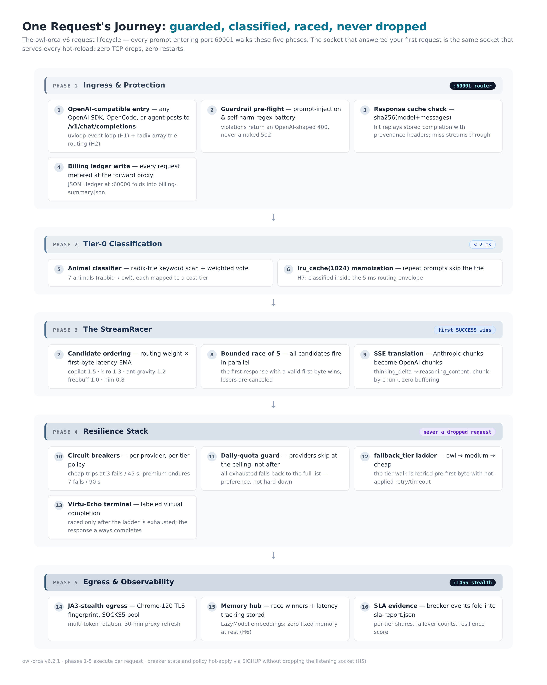
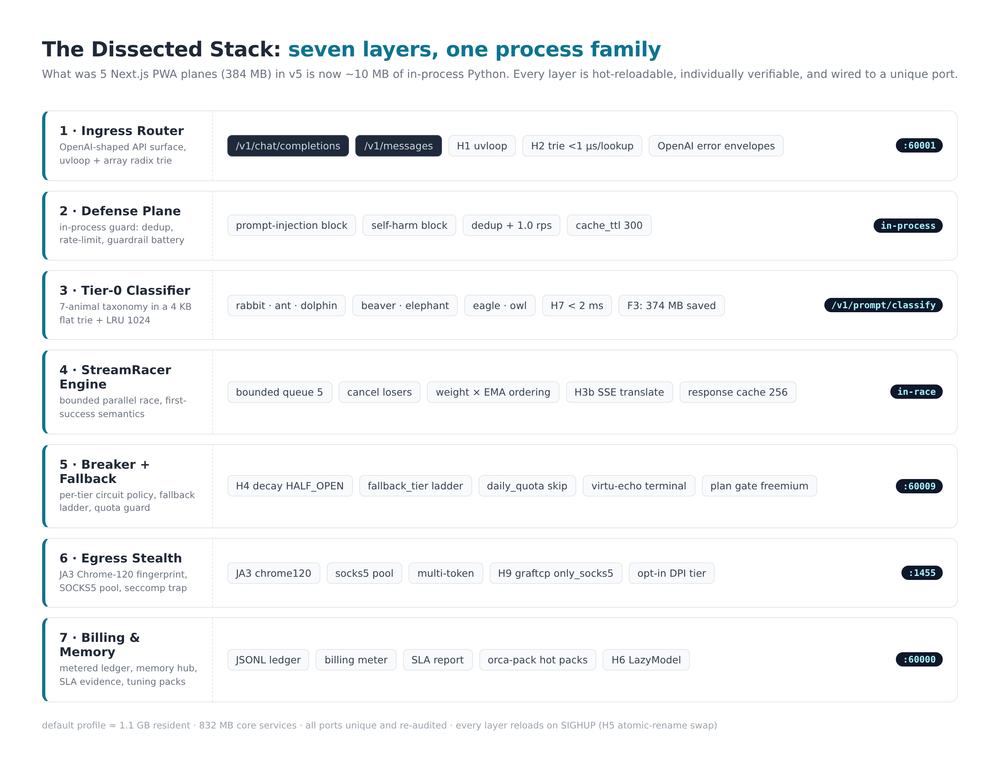
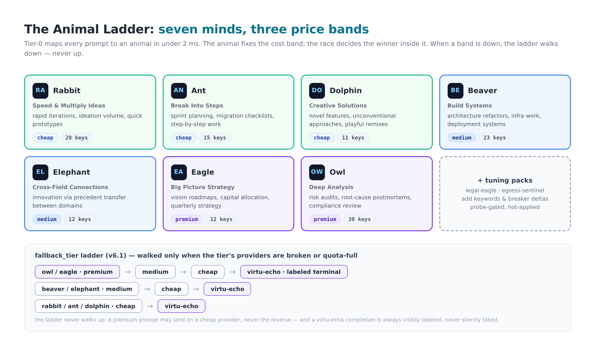
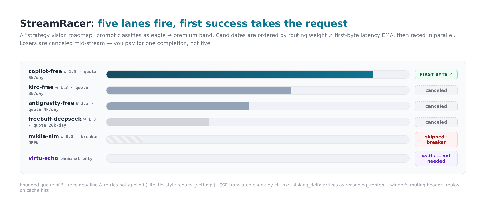
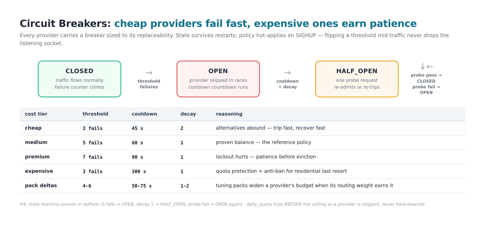
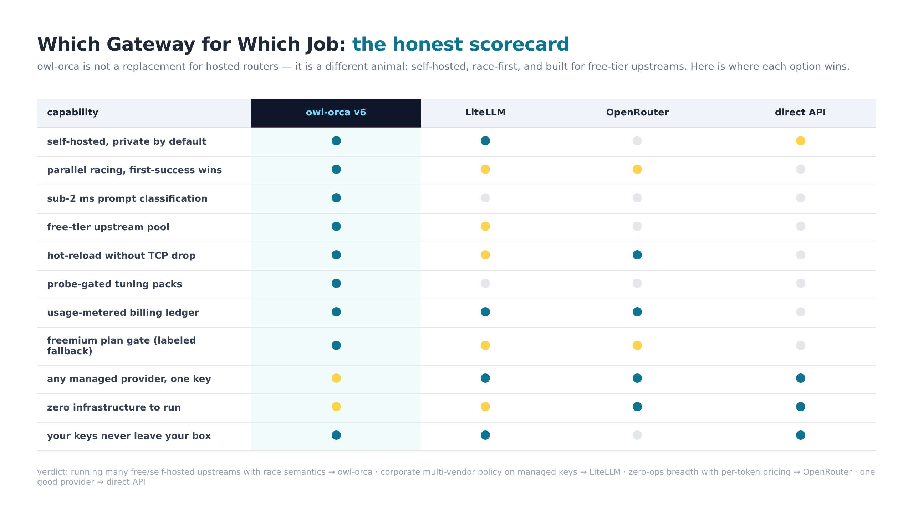
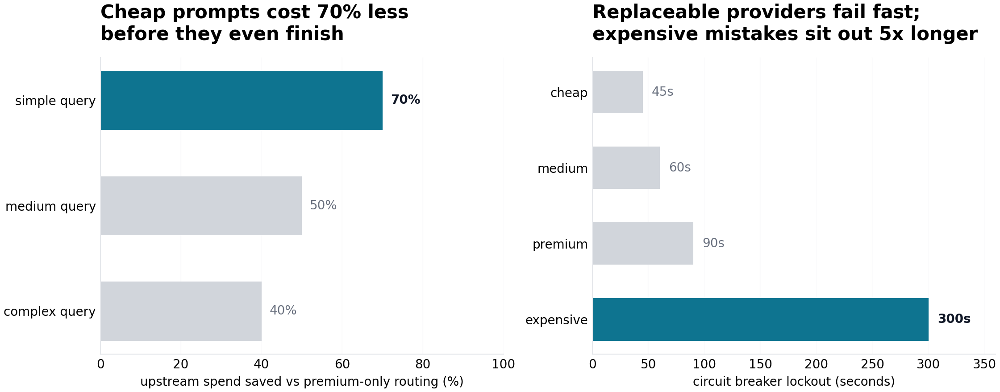
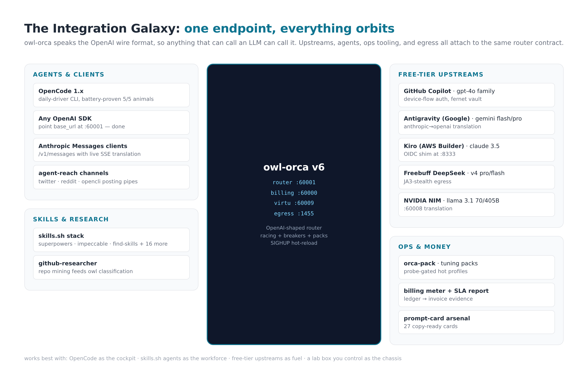
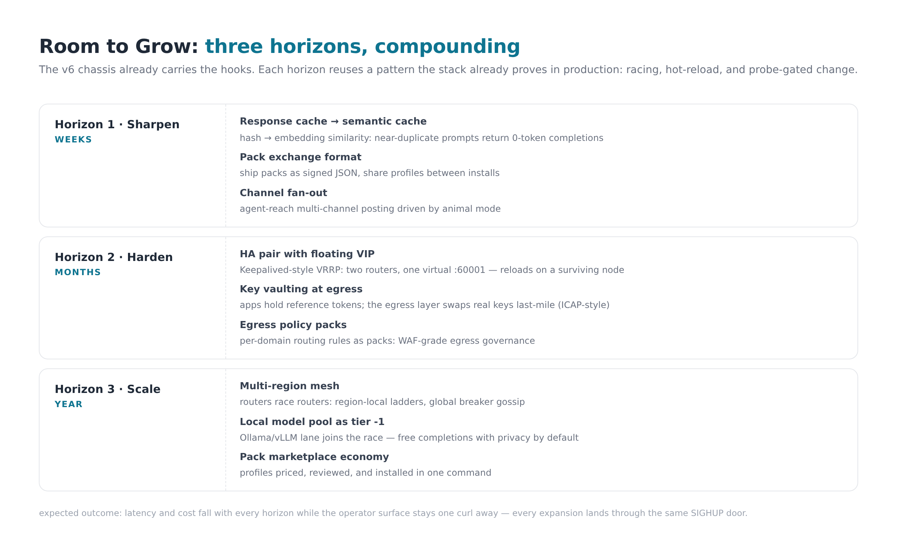
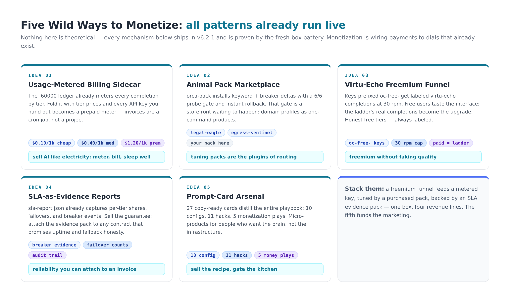

<div align="center">


# Owl-Orca v6 — The Self-Hosted AI Gateway That Races LLMs So You Never Wait

**A zero-cost, OpenAI-compatible LLM router that classifies every prompt in < 2 ms, races five upstreams in parallel, breaks failing providers automatically, and hot-reloads everything without dropping a single TCP connection.**

`v6.2.1` · single-file installer · 51/51 self-audit · proven under real OpenCode agent traffic

[](LICENSE)
[](install.sh)
[](ops/audit_v6.py)
[](ops/oc_battery.sh)
[](#)

[Quickstart](#-quickstart--60-seconds) · [Architecture](#-the-big-picture) · [Secret Sauce](#-the-secret-sauce) · [Comparison](#-how-it-compares) · [Monetization](#-five-wild-ways-to-monetize) · [Wiki](docs/)

</div>

---

## 🎯 Objective, Purpose & Use-Case

**Objective.** Run one OpenAI-shaped endpoint on your own box that is *faster, cheaper, and more reliable than any single provider* — by treating every free-tier and self-hosted upstream as a replaceable lane in a race, not a dependency.

**Purpose.** Agents burn tokens all day. A single upstream gives you one latency profile, one rate limit, one outage budget — and one bill. Owl-Orca exists so that an agent's 400th request of the day answers as fast as its first: classify the prompt, pick the right price band, fire five candidates at once, take the first valid byte, cancel the rest, and if everything is broken, still return a labeled completion instead of an error.

**Use-cases.**

| You are... | You get... |
|---|---|
| **OpenCode / CLI agent operator** | a `base_url` that never 502s — proven with a 5-animal battery under real agent traffic |
| **AI tinkerer on a budget** | five free-tier upstreams pooled behind one key, with quota + breaker discipline baked in |
| **Privacy-first builder** | self-hosted router; your keys live in a Fernet vault on your disk, never in a vendor's multi-tenant proxy |
| **Indie SaaS founder** | billing ledger, plan gate and SLA evidence already wired — see [Monetization](#-five-wild-ways-to-monetize) |
| **Ops engineer** | SIGHUP hot-reload, per-tier circuit breakers, probe-gated change management — treat routing like infrastructure |

**Everyday benefit.** The prompt you're about to send gets answered by whichever of your upstreams is *actually fast right now* — automatically, on every request, with receipts (`sla-report.json`) to prove it.

---

## ⚡ Quickstart — 60 Seconds

```bash
# 1. Install (self-contained: creates ~/.owl-orca-v6, venv, systemd units, configs)
bash install.sh

# 2. Verify the stack (51-check self-audit + service health)
python3 ops/audit_v6.py          # 51/51 PASS
~/.owl-orca-v6/bin/orca-health-check.sh

# 3. Point anything OpenAI-compatible at it
curl http://127.0.0.1:60001/v1/chat/completions \
  -H 'Content-Type: application/json' \
  -d '{"model":"copilot-free","messages":[{"role":"user","content":"strategy vision roadmap"}]}'
```

For OpenCode, set the provider `base_url` to `http://127.0.0.1:60001/v1` — the full walkthrough (including OpenCode wiring, pack installs, and the traffic battery) lives in the **[wiki](docs/)**.

> **Requirements:** Linux · Python 3.12 · ~1.1 GB RAM for the default profile · root optional (systemd user units otherwise). Tokens for upstreams are stored Fernet-encrypted at install; none ship in this repo.

---

## 🗺️ The Big Picture



One request, five phases: **ingress & protection → tier-0 classification → the StreamRacer → resilience stack → egress & observability**. The whole lifecycle is executed per request, and the listening socket that served your first request is the same one that survives every config hot-reload.

### The chain, layer by layer



| # | Layer | Port | What it does |
|---|---|---|---|
| 1 | **Ingress Router** | `:60001` | OpenAI-shaped API; uvloop event loop + array radix trie (< 1 µs per route lookup) |
| 2 | **Defense Plane** | in-process | prompt-injection / self-harm guardrail battery, dedup, 1 rps rate limit |
| 3 | **Tier-0 Classifier** | `/v1/prompt/classify` | 7-animal taxonomy in a 4 KB flat trie + `lru_cache(1024)` — classifies in **< 2 ms** |
| 4 | **StreamRacer Engine** | in-race | bounded race of 5 candidates ordered by weight × latency EMA; first *success* wins, losers canceled mid-stream |
| 5 | **Breaker + Fallback** | `:60009` | per-tier circuit breakers, `fallback_tier` ladder, daily-quota skip, Virtu-Echo labeled terminal |
| 6 | **Egress Stealth** | `:1455` | JA3 Chrome-120 fingerprint, SOCKS5 pool, multi-token rotation; graftcp seccomp trap (opt-in) |
| 7 | **Billing & Memory** | `:60000` | JSONL usage ledger, billing meter, SLA evidence reports, hot tuning packs |

The v5 design ran this as five Next.js PWA planes (~384 MB). v6 collapsed it into ~10 MB of in-process Python — **374 MB RAM returned** — while making every layer individually verifiable and hot-reloadable.

---

## 🧪 The Secret Sauce

### 1. The Animal Ladder — semantic price discrimination in 2 ms



Every prompt is classified to one of **seven animals** — Rabbit (speed), Ant (steps), Dolphin (creative), Beaver (systems), Elephant (cross-field), Eagle (strategy), Owl (deep analysis) — and the animal fixes the cost band before a single token is spent. When a band's providers are broken or quota-full, the ladder **walks down, never up**: an Owl prompt may land on a cheap provider in a brownout; a Rabbit prompt never silently lands on a premium one. The terminal fallback (Virtu-Echo) is always *labeled* — honest degradation, never a fake answer.

### 2. StreamRacer — first *success* wins



Five candidates fire in parallel; the first response with a **valid first byte** takes the request and the losers are canceled mid-stream. You pay for one completion, not five. Losing streams are never half-rendered to the client — Anthropic-to-OpenAI SSE translation happens chunk-by-chunk (`thinking_delta` → `reasoning_content`) with zero buffering.

### 3. Circuit breakers sized by replaceability



Cheap providers trip at 3 failures and recover in 45 s (alternatives abound); premium providers endure 7 failures because lockout hurts; the expensive residential last-resort sits out 300 s — quota protection and anti-ban as policy, not folklore. Breaker **state survives restarts; policy hot-applies on SIGHUP** — flip a threshold mid-traffic and the socket never drops.

### 4. The hidden wonders (the "H" hacks)

| | | |
|---|---|---|
| **H1** uvloop event loop | **H4** breaker decay → HALF_OPEN probes | **H7** classifier LRU memoization (< 2 ms) |
| **H2** 4 KB flat array radix trie | **H5** SIGHUP atomic-rename reload, zero TCP drops | **H8** httpx singleton pool, HTTP/2, 100 conns |
| **H3** bounded race + loser cancel | **H6** LazyModel embeddings (0 MB at rest) | **H9** graftcp seccomp `only_socks5` egress trap |

Full selftest: `~/.owl-orca-v6/bin/orca-router.py --selftest` (asserts trie µs/lookup, breaker transitions, SSE translation, pool singleton, and more).

---

## 📊 How It Compares





**Owl-Orca's advantage in AI:** it is the only option that combines (a) sub-2 ms *semantic* prompt classification, (b) true parallel racing with first-success semantics, and (c) probe-gated hot tuning packs — the three things that make multi-upstream routing feel like one reliable provider instead of five flaky ones.

**Works best with:** OpenCode (or any OpenAI SDK) as the cockpit · free-tier upstreams as fuel · a Linux box you control as the chassis · skills.sh-style agents as the workforce.

**Honest boundaries:** if you need managed multi-vendor policy on corporate keys, use LiteLLM; if you need zero-ops breadth with per-token pricing, use OpenRouter. Owl-Orca wins when the upstreams are *yours* and the race is the point.

---

## 🔗 Integrations



- **Clients:** anything that speaks OpenAI or Anthropic Messages — OpenCode (battery-proven), curl, SDKs, agent frameworks
- **Upstreams:** GitHub Copilot free · Antigravity (Google) · Kiro (AWS Builder ID) · Freebuff DeepSeek · NVIDIA NIM — each with its own auth method, translation, and breaker profile; the companion proxy repos are linked in [`docs/07-integrations.md`](docs/07-integrations.md)
- **Ops:** `orca-pack.sh` tuning packs · `orca-billing-meter.py` · `orca-sla-report.py` · `agent-reach` social channels · the skills.sh agent stack

---

## 🧭 Room for Expansion



Three horizons, each reusing a pattern the stack already proves: **Sharpen** (semantic cache → 0-token hits, pack exchange format) → **Harden** (Keepalived-style HA VIP, ICAP-style key vaulting at egress) → **Scale** (multi-region router mesh, local Ollama/vLLM lane, pack marketplace economy). Depth direction and expected outcomes are mapped in [`docs/08-roadmap-synergy.md`](docs/08-roadmap-synergy.md) — including the adaptation analysis for HAProxy/Squid/Keepalived-style proxy-stack patterns.

---

## 💰 Five Wild Ways to Monetize



Every mechanism below **already runs live** in v6.2.1 — monetization is wiring payments to dials that exist. Full playbooks (extensions, tools, pricing math, demo art) in [`docs/09-monetization-ideas.md`](docs/09-monetization-ideas.md):

| # | Idea | AI extension | Tools you'd add |
|---|---|---|---|
| 1 | **Usage-metered billing sidecar** — sell completions like electricity | meter → Stripe usage records | Stripe, `orca-billing-meter.py` |
| 2 | **Animal pack marketplace** — routing profiles as one-command products | pack signing + storefront | `orca-pack.sh`, a static store, Gumroad |
| 3 | **Virtu-Echo freemium funnel** — honest labeled free tier | `oc-free-` keys → labeled completions | plan gate (built-in), auth proxy |
| 4 | **SLA-as-evidence reports** — sell the guarantee, attach the receipts | breaker evidence → contract artifact | `orca-sla-report.py`, PDF pipeline |
| 5 | **Prompt-card arsenal** — 27 copy-ready cards as micro-products | cards → gated product pages | the [`prompt-cards/`](prompt-cards/) set, any static host |

Concept art for each: [1 — billing sidecar](images/monetization-idea-1-billing-sidecar.png) · [2 — pack marketplace](images/monetization-idea-2-pack-marketplace.png) · [3 — freemium funnel](images/monetization-idea-3-freemium-funnel.png) · [4 — SLA evidence](images/monetization-idea-4-sla-evidence.png) · [5 — card arsenal](images/monetization-idea-5-prompt-card-arsenal.png)

---

## 📁 Repo Layout

```
owl-orca-v6/
├── install.sh              # single-file installer (4,134 lines, v6.2.1)
├── installer/              # installer source segments (v6_part1-6.sh)
├── src/
│   ├── bin/                # router, packs, billing, SLA, virtu-echo, forward proxy, utils
│   ├── tier0/              # animal classifier + taxonomy + scoring
│   └── config/             # providers, routes, tier prices, example packs
├── ops/                    # audit, proof batteries, traffic drivers, verification checklist
├── prompt-cards/           # 27 copy-ready prompt cards (configs, hacks, monetization)
├── docs/                   # the wiki: install, architecture, packs, runbook, roadmap, money
└── images/                 # every diagram and chart in this README
```

## 📖 The Wiki (Walkthrough Guides)

Every page is copy-ready — commands you can paste verbatim:

1. **[Installation & Setup](docs/01-installation.md)** — prerequisites, install paths, first request, OpenCode wiring
2. **[Architecture Deep-Dive](docs/02-architecture.md)** — the request lifecycle, layer by layer, with file pointers
3. **[Configuration Reference](docs/03-configuration.md)** — `providers.json`, `routes.json`, breaker policy, hot-apply semantics
4. **[Tuning Packs](docs/04-packs.md)** — install, preview, author, uninstall, `apply-all` post-reinstall recovery
5. **[Operations Runbook](docs/05-operations-runbook.md)** — health, reload, breaker ops, quota, backup/restore
6. **[Validation & Testing](docs/06-validation.md)** — selftest, audit, proof batteries, the OpenCode traffic battery
7. **[Integrations](docs/07-integrations.md)** — clients, upstreams, companion repos, agent-reach
8. **[Roadmap & Synergy](docs/08-roadmap-synergy.md)** — expansion horizons + the proxy-stack adaptation analysis
9. **[Monetization Ideas](docs/09-monetization-ideas.md)** — the five plays with extensions, tools and math

## ✅ Proof It Works

- **51/51** marker audit across the installer (`ops/audit_v6.py`)
- **9/9** fresh-box proof battery: cache hit/miss/bypass, guardrail 400s, weight ordering, hot-applied retry/timeout, quota skip, plan gate, billing math, pack probe gate, SLA report (`ops/prove_v62.sh`)
- **5/5** animals under real OpenCode 1.19.0 agent traffic, pack breaker deltas live across a full reinstall (`ops/oc_battery.sh`)
- Full checklist: [`ops/VERIFICATION.md`](ops/VERIFICATION.md) · Ops runbook: [`docs/owl-orca-v6-ops-runbook.html`](docs/owl-orca-v6-ops-runbook.html) · Upstream playbook: [`docs/owl-orca-v6.1-upstream-playbook.docx`](docs/owl-orca-v6.1-upstream-playbook.docx)

## 🔒 Security & Legal

- No credentials ship in this repo: upstream tokens are generated and stored **Fernet-encrypted (`0600`) in `~/.owl-orca-v6`** at install time, never committed
- Guardrails block prompt-injection patterns before they reach an upstream; egress is auditable and seccomp-confinable
- **Use your own accounts and respect each upstream's terms of service** — free tiers are a grant, not a loophole; this project manages *your* quotas, it does not evade anyone's limits
- See [`SECURITY.md`](SECURITY.md) for reporting and hardening notes

## ❓ FAQ

**Is this an OpenAI proxy?** It's an *OpenAI-compatible router* — it accepts OpenAI-shaped requests and fans them out to whichever upstreams you configure (free-tier, self-hosted, or paid). It never impersonates OpenAI.

**What if all upstreams are down?** Virtu-Echo returns a clearly-labeled virtual completion (`X-Owl-Orca-Route: virtu_echo`) instead of an error — your agent keeps moving, and the SLA report records the brownout.

**Can I add my own provider?** Yes — one JSON block in `providers.json` + `orca-reload.sh`. See [`docs/03-configuration.md`](docs/03-configuration.md).

**Does hot-reload really not drop connections?** Yes — configs are written to a temp file and atomically renamed, then SIGHUP re-reads them; the health check proves the socket stays `LISTEN` through reloads (H5).

**Why animals?** Because "route cheap prompts to cheap providers" is forgettable, and "Rabbits go fast, Owls go deep" is not. The taxonomy is also the pack system's extension point.

## 📄 License

MIT — see [`LICENSE`](LICENSE). Upstream providers keep their own terms; this repo ships only original code.

<div align="center">

**Built for operators who'd rather race five providers than wait on one.**

⭐ Star it · 🍴 Fork it · 🐦 Follow the build log on X: [@markytanky](https://x.com/markytanky)

</div>
